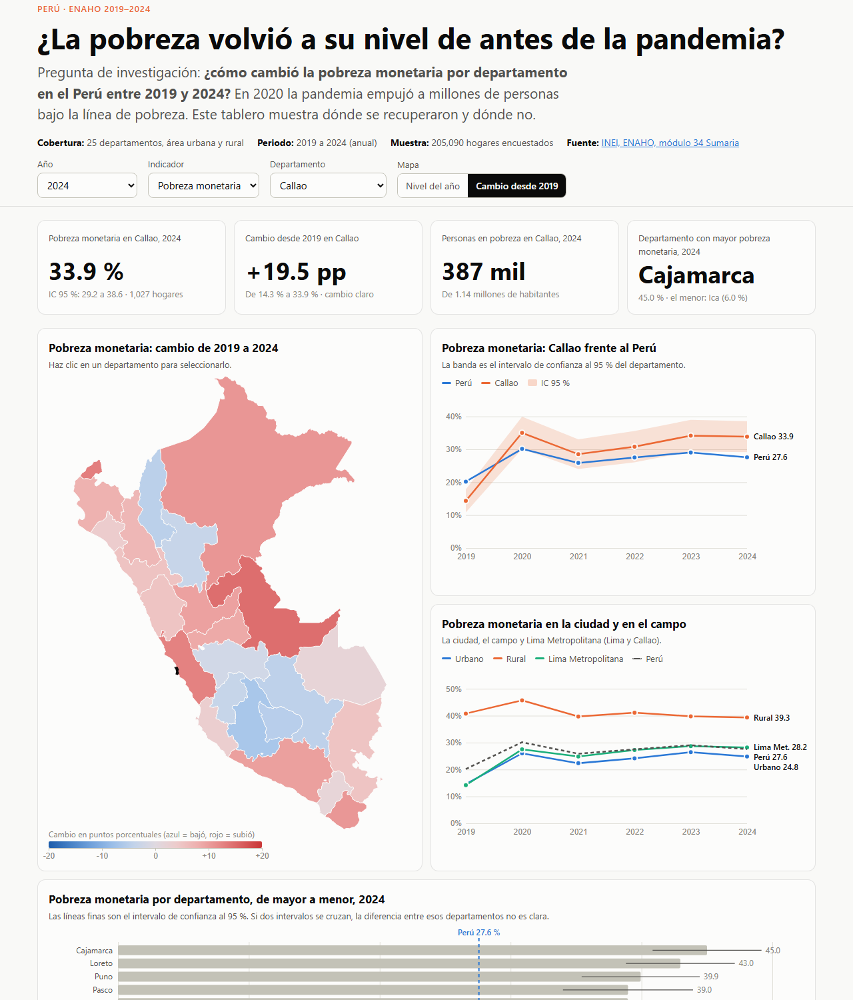
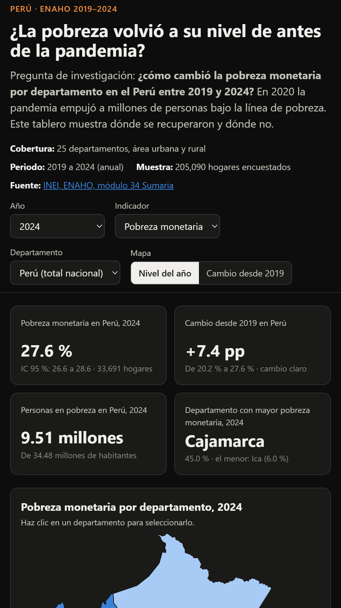
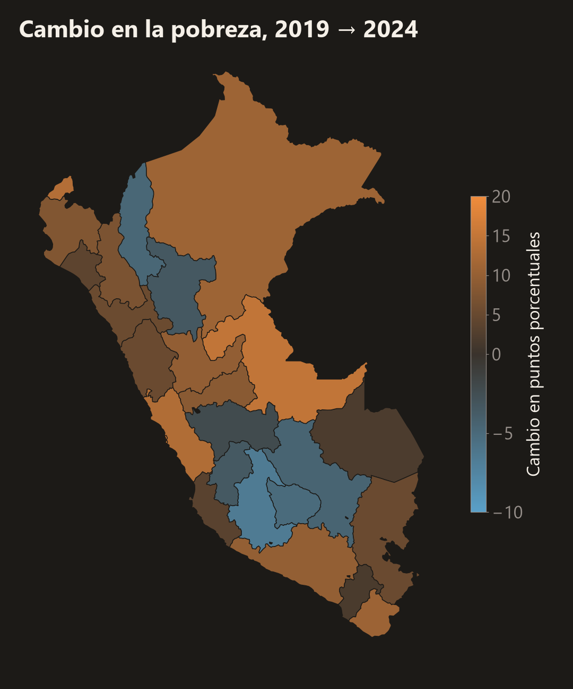
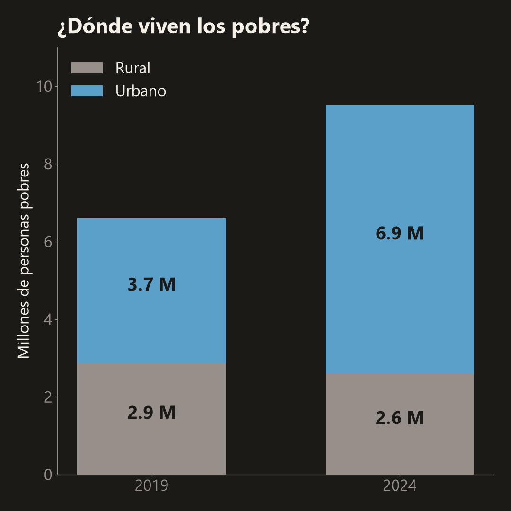

# ¿La pobreza volvió a su nivel de antes de la pandemia?

**Pobreza monetaria por departamento en el Perú, 2019-2024, con los microdatos de la ENAHO del INEI.**

Tarea 3 del curso Python Intermedio (QLAB PUCP, 2026): *Del dato a la historia, dashboard interactivo y reel con IA*.

| | |
|---|---|
| 🌐 **Dashboard** | https://jhane080.github.io/pobreza-peru-enaho/ |
| 🎬 **Reel** | [`reel/reel.mp4`](reel/reel.mp4) |
| 💼 **LinkedIn** | _(enlace a la publicación)_ |



## 1. Tema y pregunta de investigación

En 2020 la pandemia empujó a millones de peruanos bajo la línea de pobreza. Cinco años después,
la pregunta es si el país se recuperó y, sobre todo, **dónde**:

> **¿Cómo cambió la pobreza monetaria por departamento en el Perú entre 2019 y 2024?**

- **Cobertura geográfica:** los 25 departamentos (Lima y Callao por separado), área urbana y rural, y regiones naturales.
- **Cobertura temporal:** 2019 (antes de la pandemia) a 2024, el último año publicado por el INEI.

## 2. El proyecto en breve

1. **Datos:** la sumaria (módulo 34) de la ENAHO anual 2019-2024: 205,090 hogares encuestados.
2. **Indicadores:** pobreza monetaria, pobreza extrema y brecha de pobreza, ponderados por personas,
   con intervalos de confianza al 95 % que respetan el diseño de la encuesta.
3. **Dashboard** (HTML + D3, publicado con GitHub Pages): 4 KPIs, mapa coroplético, serie de tiempo
   con banda de confianza, comparación urbano/rural, ranking de departamentos y tabla con buscador y
   descarga en CSV. Se controla con 4 filtros (año, indicador, departamento y modo del mapa) y con clics
   sobre el mapa, el ranking o la tabla.
4. **Reel** de 9:16 narrado con mi voz clonada (Qwen3-TTS), con mapas, gráficos y capturas del dashboard,
   música de fondo y subtítulos sincronizados.

## 3. Fuentes y metodología

### Fuentes

| Fuente | Qué se usó | Enlace |
|---|---|---|
| INEI, Encuesta Nacional de Hogares (ENAHO) | Módulo 34 *Sumaria*, anual 2019 a 2024 (códigos 687, 737, 759, 784, 906 y 966), formato Stata. Descargado el 1 de noviembre de 2026 | [proyectos.inei.gob.pe/microdatos](https://proyectos.inei.gob.pe/microdatos/) |
| INEI, *Evolución de la pobreza monetaria* | Cifras oficiales nacionales para validar | [inei.gob.pe](https://www.inei.gob.pe/) |
| Límites departamentales | GeoJSON simplificado del curso | [d2cml-ai/Data-Science-Python](https://github.com/d2cml-ai/Data-Science-Python/tree/main/sessions/06-geoespacial) |

### Cómo se construyeron los indicadores

- **Pobreza monetaria:** % de personas cuyo gasto mensual per cápita no alcanza la línea de pobreza
  (variable `pobreza`, códigos 1 y 2). **Pobreza extrema:** código 1.
- **Brecha de pobreza:** promedio de `max(0, (línea − gasto per cápita) / línea)`. Mide qué tan lejos de
  la línea están los pobres.
- **Ponderación:** cada hogar pesa `factor07 × mieperho` (las personas que representa), como hace el INEI.
- **Ubigeo:** se lee como texto de 6 dígitos; el departamento son los 2 primeros (`"07"` es Callao).
- **Intervalos de confianza al 95 %:** linealización de Taylor con estratos = departamento × `estrato`
  y conglomerado = `conglome`.
- **"Cambio claro":** solo cuando los intervalos de 2019 y 2024 no se tocan. Es una regla exigente a propósito.

### Validación

La cifra nacional replica la oficial del INEI en los seis años
([`datos/procesados/validacion.txt`](datos/procesados/validacion.txt)):

| Año | 2019 | 2020 | 2021 | 2022 | 2023 | 2024 |
|---|---|---|---|---|---|---|
| Este proyecto | 20.19 % | 30.13 % | 25.87 % | 27.52 % | 29.05 % | 27.58 % |
| INEI oficial | 20.2 % | 30.1 % | 25.9 % | 27.5 % | 29.0 % | 27.6 % |

## 4. Tres hallazgos

**1. La pobreza no volvió a su nivel de antes de la pandemia.** Pasó de 20.2 % en 2019 a 30.1 % en 2020
y en 2024 seguía en 27.6 %. Son 9.5 millones de personas pobres, 2.9 millones más que en 2019. La
pobreza extrema casi se duplicó: de 2.9 % a 5.5 %.

**2. La pobreza se volvió más urbana.** En las ciudades subió de 14.6 % a 24.8 %, y en Lima Metropolitana
se duplicó (14.2 % a 28.2 %). Hoy 7 de cada 10 pobres viven en zonas urbanas; en 2019 eran 57 %. En el
campo la pobreza total casi no cambió (40.8 % a 39.3 %, dentro del margen de error), pero la pobreza
extrema rural subió de 9.8 % a 15.5 %.

**3. El golpe fue desigual entre departamentos.** En 10 de 25 departamentos la pobreza de 2024 es
claramente mayor que la de 2019 (Arequipa, Callao, Huánuco, Ica, Lima, Loreto, Piura, Tacna, Tumbes
y Ucayali), y en ninguno es claramente menor. Callao subió 19.5 puntos (14.3 % a 33.9 %), Ucayali 14.8
y Tumbes 13.2. Ayacucho, Apurímac, Amazonas y Cusco bajaron de 4 a 7 puntos, pero dentro del margen
de error. Cajamarca (45.0 %), Loreto (43.0 %) y Puno (39.9 %) tienen la pobreza más alta en 2024.

<p>



</p>

## 5. Limitaciones

- La ENAHO es una encuesta: por departamento los márgenes de error son de 3 a 6 puntos. Diferencias
  pequeñas entre departamentos o años pueden no ser reales; por eso el dashboard muestra los intervalos.
- En 2020 parte de las entrevistas se hizo por teléfono por la pandemia; ese año es menos comparable.
- La pobreza monetaria mide el gasto, no el acceso a servicios, salud o educación.
- El INEI publica algunos departamentos agrupados por su margen de error; aquí se muestran por separado.
  El intervalo de confianza usa una aproximación del diseño muestral (estratos departamento × `estrato`).
- Es un análisis descriptivo: muestra dónde cambió la pobreza, no por qué.

## 6. Enlaces

- Dashboard: https://jhane080.github.io/pobreza-peru-enaho/
- Publicación de LinkedIn: _(enlace)_
- Repositorio: https://github.com/Jhane080/pobreza-peru-enaho

El dashboard acepta filtros en la URL para compartir una vista, por ejemplo
[Callao, cambio desde 2019](https://jhane080.github.io/pobreza-peru-enaho/?departamento=07&mapa=cambio).

## 7. Cómo reproducirlo

Requiere [uv](https://docs.astral.sh/uv/) y Python 3.12.

```bash
uv sync
uv run python scripts/obtener_datos.py     # baja la sumaria 2019-2024 del INEI (~16 MB por año)
uv run python scripts/procesar_datos.py    # indicadores, validación y datos del dashboard
uv run python scripts/analizar_datos.py    # hallazgos y figuras
uv run python -m http.server -d docs       # dashboard en http://localhost:8000
```

Quien no use uv puede instalar con `pip install -r requirements.txt`.

El reel usa un entorno aparte ([`reel/requirements-reel.txt`](reel/requirements-reel.txt)) con
Qwen3-TTS-12Hz-0.6B-Base y faster-whisper-small descargados en una carpeta local:

```bash
python reel/hacer_reel.py --voz reel/recursos/mi_voz.mp4 --modelos <carpeta con los modelos>
```

### Estructura

```text
├── scripts/
│   ├── obtener_datos.py      # descarga del portal de microdatos del INEI
│   ├── procesar_datos.py     # limpieza, indicadores, intervalos y validación
│   └── analizar_datos.py     # hallazgos y figuras
├── datos/
│   ├── originales/           # microdatos del INEI (no se suben: se bajan con el script)
│   ├── limites/              # GeoJSON de departamentos
│   └── procesados/           # tablas finales, hallazgos.json y validacion.txt
├── docs/                     # el dashboard (GitHub Pages)
│   ├── index.html
│   └── data/                 # pobreza.json y departamentos.geojson
├── figuras/                  # gráficos y mapas del análisis y del reel
├── capturas/                 # capturas del dashboard
└── reel/
    ├── guion.json            # guion revisado contra los datos
    ├── hacer_reel.py         # voz clonada, video, música y subtítulos
    ├── reel.mp4
    ├── subtitulos.srt
    └── recursos/musica.wav   # música generada con Python
```

## 8. Uso de inteligencia artificial

- **Claude Code** (Anthropic) me ayudó a escribir el código de descarga, procesamiento, análisis,
  dashboard y reel, y a redactar los textos. Revisé las cifras: la cifra nacional de cada año se valida
  automáticamente contra la oficial del INEI, y cada número del guion sale de `datos/procesados/hallazgos.json`.
- **Qwen3-TTS** generó la narración clonando mi propia voz a partir de una nota de voz mía.
  **faster-whisper** volvió a escuchar cada escena para controlar que se entendiera y para sincronizar
  los subtítulos.
- La música no es de terceros: la genera el propio script con ondas seno.
